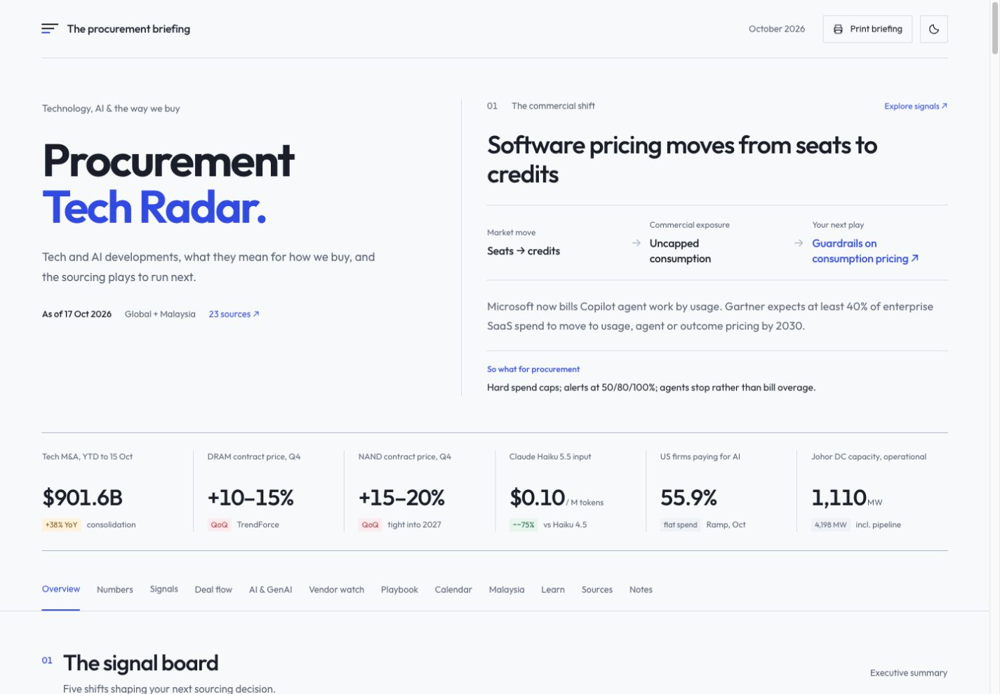

# Procurement Tech Radar

**Technology intelligence, translated into procurement action.**

A self-contained briefing for people buying technology and AI. Each market move connects to commercial exposure and a practical sourcing play, with a global view and a Malaysia/ASEAN lens.

## Inside the briefing

- Six headline indicators and five executive signals
- M&A deal flow with reported transactions clearly marked
- AI/GenAI trends and a model-price comparison
- Eight vendor positions and eight sourcing plays
- An action calendar with live countdowns
- Malaysia data-centre capacity and an AI Governance Bill tracker
- A ten-term glossary and five-question quiz
- Twenty-three numbered source links

Responsive from 360px phones to wide desktops, with light/dark themes, keyboard access, accessible chart descriptions and print styles.

## Open it

Download `index.html` and open it in a browser. No installation, account or server is needed.

The entire briefing is one HTML file, with inline styles, JavaScript and an editable data object. Outfit is loaded from Google Fonts when available, with system-font fallbacks. There is no backend, analytics or submission form. Theme preference is stored locally; quiz answers reset when the page reloads.

## Refresh the edition

Find `const RADAR_DATA` inside `index.html` and update the dated snapshot, content, figures, calendar targets, quiz answers and sources. The page renders from that object on load. Keep source URLs on HTTPS and verify reported/forecast labels before sharing.

Data-only edits update the JavaScript-rendered page. The original pre-rendered fallback remains available when JavaScript is disabled and requires rebuilding to reflect later edits.

## Content note

This edition is a **17 October 2026 snapshot**, not a live news feed. The source material was supplied for the briefing; factual accuracy and source availability were not independently verified as part of the build. Check current vendor terms, prices and policy status before relying on them. A countdown passing does not confirm that an expected event happened.

Prepared for procurement planning. Not legal or financial advice. Figures change quickly; refresh monthly.

## Validation

Browser checks covered 360px, 768px and 1440px layouts, contained table scrolling, both themes, keyboard interaction, section navigation, live countdowns, and quiz completion/restart. Automated checks covered all 32 correct/incorrect quiz paths, date boundaries, chart scales, content/source counts and text contrast. Print styles are included; native print output has not been independently inspected.
